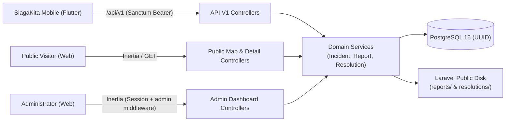

# SiagaKita Web — Implementation Plan & Task Breakdown

## Goal Description

Build **SiagaKita Web** (`siagakita-web`) as the centralized backend, REST API (`/api/v1`), Public Monitoring Web, and Admin Dashboard for the SiagaKita disaster reporting and monitoring platform, based on [PRD.md](./PRD.md) and running via Docker ([Makefile](../Makefile), [docker-compose.yaml](../docker-compose.yaml)).

The system implements:

1. **Core Domain & Database (UUID Primary Keys)**: Users (`citizen` / `admin`), Incidents, Reports, Report Media, Resolution Submissions, Resolution Media, and Incident Status Histories.
2. **REST API (`/api/v1`)**: Sanctum-authenticated endpoints for the Flutter mobile app (auth, disaster reporting with GPS & media, incident map/list/detail, additional reports, resolution submissions).
3. **Public Monitoring Web**: Unauthenticated interactive OpenStreetMap (`react-leaflet`) showing all visible incidents (`unverified`, `verified`, `resolution_submitted`, `resolved`), status & disaster-type filters, report counts, and incident detail with evidence viewer.
4. **Admin Dashboard**: Role-protected Inertia + React (`shadcn/ui`) workspace for overview metrics, report verification/rejection, nearby-incident grouping recommendations (**Multiple Reports, One Incident**), resolution verification, and user management.

---

## Key Technical Decisions

- **Primary Keys (`UUID`)**: All domain tables (`users`, `incidents`, `reports`, `report_media`, `resolution_submissions`, `resolution_media`, `incident_status_histories`) use `uuid('id')->primary()` with Laravel's `HasUuids` trait.
    - `sessions.user_id` uses `foreignUuid('user_id')->nullable()->index()`.
    - Sanctum `personal_access_tokens` uses `uuidMorphs('tokenable')` so API tokens bind cleanly to UUID `User` records.
- **Database Engine (`postgres:16` vs PostGIS)**: Keeps `postgres:16` in `docker-compose.yaml` and uses indexed `(latitude, longitude)` bounding-box pre-filtering + Haversine distance calculation in SQL/PHP for city-level nearby-incident grouping recommendations. Fixes `DB_PORT=5432` in `.env.example`.
- **Design Direction (`antislop` During Mode + `shadcn/ui`)**:
    - **Dials**: `ENERGY 2 / RHYTHM 2 / MOTION 1` — clean, high-contrast civic monitoring UI built on the existing `shadcn/ui` (`radix-nova`) token system in `resources/css/app.css`.
    - **Status Palette**: Semantic, WCAG AA-compliant status indicators for `unverified` (amber), `verified` (red-orange alert), `resolution_submitted` (blue/indigo), `resolved` (emerald), and `rejected` (neutral slate).
    - **UI Completeness**: Every data view includes loading, empty, and error states, keyboard navigation, and mobile responsiveness (`44px` minimum tap targets, zero horizontal overflow).

---

## Architecture Overview

---

## Proposed Changes

### 1. Environment, Docker & Packages

- **`.env.example`**: Update `DB_PORT=3306` to `DB_PORT=5432` and `APP_NAME=SiagaKita`.
- **`composer.json`**: Install `laravel/sanctum` via Composer inside the `web` container.
- **`package.json`**: Install `leaflet`, `react-leaflet`, and `@types/leaflet` via npm.
- **Storage**: Run `php artisan storage:link` in the container so `/storage/reports/...` and `/storage/resolutions/...` are publicly servable.

---

### 2. Database Schema, Enums & Models (UUID)

#### Enums in `app/Enums/`

- `UserRole.php`: `Citizen = 'citizen'`, `Admin = 'admin'`
- `DisasterType.php`: `Flood = 'flood'`, `Earthquake = 'earthquake'`, `Landslide = 'landslide'`, `Fire = 'fire'` (with `label()`, `titlePrefix()`, `color()`)
- `IncidentStatus.php`: `Unverified = 'unverified'`, `Verified = 'verified'`, `ResolutionSubmitted = 'resolution_submitted'`, `Resolved = 'resolved'`, `Rejected = 'rejected'` (with `isPubliclyVisible(): bool` and `allowedTransitions(): array`)
- `ModerationStatus.php`: `Pending = 'pending'`, `Verified = 'verified'`, `Rejected = 'rejected'`
- `ResolutionStatus.php`: `Pending = 'pending'`, `Approved = 'approved'`, `Rejected = 'rejected'`
- `MediaType.php`: `Image = 'image'`, `Video = 'video'`

#### Migrations in `database/migrations/`

1. `0001_01_01_000000_create_users_table.php` (updated): `uuid('id')->primary()`, `role` (`string`, default `'citizen'`, indexed), and `foreignUuid('user_id')->nullable()->index()` on `sessions`.
2. `create_personal_access_tokens_table.php` (Sanctum): Uses `uuidMorphs('tokenable')` for UUID `User` compatibility.
3. `create_incidents_table.php`: `uuid('id')->primary()`, `title`, `description`, `latitude` (`decimal(10, 7)`), `longitude` (`decimal(10, 7)`), `address` (`nullable`), `status` (`string`, default `'unverified'`, indexed), `verified_by` (`foreignUuid nullable constrained users`), `verified_at` (`nullable`), `resolved_at` (`nullable`), `timestamps`. Composite indexes on `['latitude', 'longitude']` and `['status', 'created_at']`.
4. `create_reports_table.php`: `uuid('id')->primary()`, `incident_id` (`foreignUuid nullable constrained incidents nullOnDelete`), `user_id` (`foreignUuid constrained users cascadeOnDelete`), `description`, `latitude` (`decimal(10, 7)`), `longitude` (`decimal(10, 7)`), `submitted_at`, `moderation_status` (`string`, default `'pending'`, indexed), `reviewed_by` (`foreignUuid nullable constrained users`), `reviewed_at` (`nullable`), `rejection_reason` (`nullable`), `timestamps`.
5. `create_report_media_table.php`: `uuid('id')->primary()`, `report_id` (`foreignUuid constrained reports cascadeOnDelete`), `file_path`, `file_type`, `original_filename`, `file_size`, `created_at`.
6. `create_resolution_submissions_table.php`: `uuid('id')->primary()`, `incident_id` (`foreignUuid constrained incidents cascadeOnDelete`), `user_id` (`foreignUuid constrained users cascadeOnDelete`), `description`, `status` (`string`, default `'pending'`, indexed), `reviewed_by` (`foreignUuid nullable constrained users`), `reviewed_at` (`nullable`), `rejection_reason` (`nullable`), `timestamps`.
7. `create_resolution_media_table.php`: `uuid('id')->primary()`, `resolution_submission_id` (`foreignUuid constrained resolution_submissions cascadeOnDelete`), `file_path`, `file_type`, `original_filename`, `file_size`, `created_at`.
8. `create_incident_status_histories_table.php`: `uuid('id')->primary()`, `incident_id` (`foreignUuid constrained incidents cascadeOnDelete`), `previous_status` (`nullable`), `new_status`, `changed_by` (`foreignUuid constrained users`), `reason` (`nullable`), `created_at`.
9. `add_disaster_type_to_incidents_table.php`: `disaster_type` (`string`, default `'flood'`, indexed). Stored as a plain string so new enum cases need no schema migration; a future lookup table can be introduced without changing `incidents` structure.

#### Models, Factories & Seeders

- `User` uses `HasUuids`, `HasApiTokens`, `role` cast to `UserRole`, `isAdmin()`.
- `Incident`, `Report`, `ReportMedia`, `ResolutionSubmission`, `ResolutionMedia`, `IncidentStatusHistory` all use `HasUuids` with explicit `casts()`, relationships, and query scopes.
- Factories and `DatabaseSeeder` (1 Admin: `admin@siagakita.test`, sample Citizens, and Incidents in all statuses).

---

### 3. Domain Services & Authorization

- `MediaStorageService`: Validates and stores uploaded photos/videos (`jpg,jpeg,png,webp,mp4,mov`, max 20MB) to `public` disk under `reports/` or `resolutions/`, returns metadata, and cleans up files on DB rollback.
- `IncidentService`:
    - `findNearbyCandidates(float $lat, float $lng, ?string $excludeIncidentId = null, ?DisasterType $type = null, float $radiusKm = 1.5, int $hoursWindow = 72): Collection`: Bounding-box + Haversine distance calculation, optionally restricted to the same disaster type.
    - `transitionStatus(Incident $incident, IncidentStatus $newStatus, User $actor, ?string $reason = null): Incident`: Atomic status transition + `IncidentStatusHistory` audit log.
- `ReportService`:
    - `createInitialReport`, `addReportToIncident`, `verifyReport`, `rejectReport`, `groupReportIntoIncident` (atomic DB transactions, preserves all report records and media, prevents multi-incident assignment, rejects cross-disaster-type grouping).
- `ResolutionService`:
    - `submitResolution`, `approveResolution` (`resolved`), `rejectResolution` (`verified` + reason + history).
- `EnsureUserIsAdmin` middleware (aliased as `admin` in `bootstrap/app.php`).

---

### 4. REST API `/api/v1` (Sanctum)

- **Public**:
    - `POST /api/v1/auth/register`
    - `POST /api/v1/auth/login`
    - `GET /api/v1/incidents` (`?status=`, `?type=`)
    - `GET /api/v1/incidents/map` (`?status=`, `?type=`)
    - `GET /api/v1/incidents/{incident}`
- **Authenticated (`auth:sanctum`)**:
    - `POST /api/v1/auth/logout`
    - `GET /api/v1/auth/me`
    - `POST /api/v1/reports`
    - `GET /api/v1/reports/my`
    - `POST /api/v1/incidents/{incident}/reports`
    - `POST /api/v1/incidents/{incident}/resolutions`

---

### 5. Web Routes & Frontend UI (Inertia + React + `shadcn/ui` + React Leaflet)

- **Public Monitoring Web**:
    - `GET /` (`Public\IncidentMapController@index`) -> `resources/js/pages/public/map.tsx`
    - `GET /incidents/{incident}` (`Public\IncidentMapController@show`) -> `resources/js/pages/public/incident-detail.tsx`
- **Admin Dashboard (`auth`, `verified`, `admin`)**:
    - `GET /admin` -> `resources/js/pages/admin/dashboard.tsx`
    - `GET /admin/reports`, `GET /admin/reports/{report}`, `POST /admin/reports/{report}/verify|reject|group` -> `resources/js/pages/admin/reports/`
    - `GET /admin/incidents`, `GET /admin/incidents/{incident}` -> `resources/js/pages/admin/incidents/`
    - `GET /admin/resolutions`, `POST /admin/resolutions/{resolution}/approve|reject` -> `resources/js/pages/admin/resolutions/`
    - `GET /admin/users`, `PATCH /admin/users/{user}/role` -> `resources/js/pages/admin/users/`

---

## Task Breakdown (Execution Checklist)

> Update checkboxes (`[x]`) as each task is completed so team members and AI assistants stay in sync.

- [x] **Phase 1 — Foundation & Docker Sync**
    - [x] Fix `DB_PORT=5432` in `.env.example` / `.env` and verify Docker containers (`make serve` / `make ps`).
    - [x] Install `laravel/sanctum` and `leaflet` + `react-leaflet` + `@types/leaflet`.
    - [x] Run `php artisan storage:link` in container.
- [x] **Phase 2 — Database (UUID), Models & Seeder**
    - [x] Create domain Enums (`UserRole`, `DisasterType`, `IncidentStatus`, `ModerationStatus`, `ResolutionStatus`, `MediaType`).
    - [x] Update `users`/`sessions` migration to UUID + `role`, configure Sanctum `personal_access_tokens` with `uuidMorphs`, and create domain migrations (`incidents`, `reports`, `report_media`, `resolution_submissions`, `resolution_media`, `incident_status_histories`).
    - [x] Add `incidents.disaster_type` (multi-disaster: flood, earthquake, landslide, fire) with enum cast and type-aware filtering/grouping.
    - [x] Implement Eloquent models (`HasUuids`), relationships, scopes, factories, and `DatabaseSeeder`.
    - [x] Run `make migrate-fresh` inside container and verify schema.
- [x] **Phase 3 — Domain Services & REST API (`/api/v1`)**
    - [x] Implement `MediaStorageService`, `IncidentService`, `ReportService`, `ResolutionService`.
    - [x] Implement `EnsureUserIsAdmin` middleware and register in `bootstrap/app.php`.
    - [x] Implement `/api/v1` routes, `FormRequest`s, `JsonResource`s, and `Api\V1` controllers.
    - [x] Write Pest Feature tests for all `/api/v1` endpoints & edge cases.
- [x] **Phase 4 — Admin & Public Web Backend**
    - [x] Implement `Public\IncidentMapController` (`/` and `/incidents/{incident}`).
    - [x] Implement `Admin\DashboardController`, `ReportManagementController`, `IncidentManagementController`, `ResolutionVerificationController`, `UserManagementController`.
    - [x] Write Pest Feature tests for admin authz, verification, grouping, and resolution flows.
- [x] **Phase 5 — Frontend UI (Public & Admin)**
    - [x] Build shared `siagakita/` components (`StatusBadge`, `DisasterMap`, `MediaGallery`, `EmptyState`).
    - [x] Build Public Map (`/`) and Public Incident Detail (`/incidents/{incident}`).
    - [x] Update `AppSidebar` and build Admin pages (`dashboard`, `reports`, `incidents`, `resolutions`, `users`).
- [x] **Phase 6 — Verification & Polish**
    - [x] Run `composer test` (Pint, Larastan, Pest) and `npm run types:check`, `npm run build` inside Docker.
    - [ ] Click-through verification on desktop & mobile viewports + light/dark modes.
    - [x] Create `walkthrough.md` artifact.
